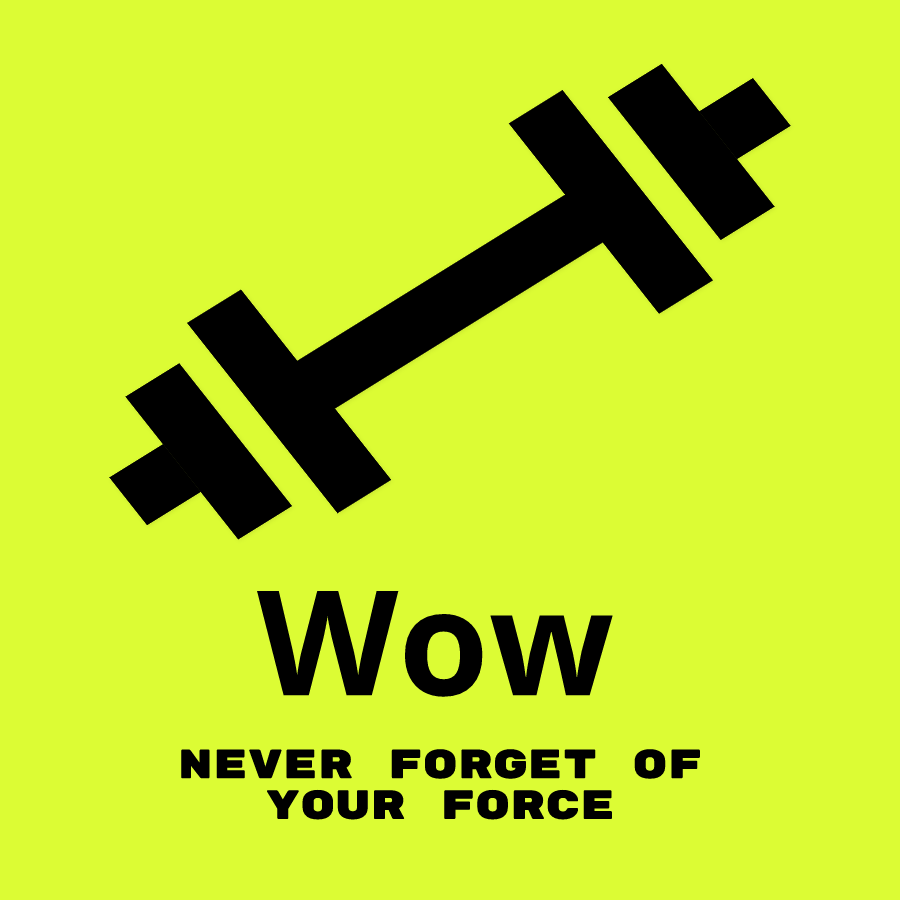

<div align="center">

<h1>Way Of The Weights 🏋🏽‍♂️</h1>



SaaS de treino focado na **evolução de força**: registre cargas, séries e repetições e acompanhe quanto você ficou mais forte.

</div>

## Índice

1. [Visão geral](#visão-geral)
2. [Tecnologias](#tecnologias)
3. [Estrutura do repositório](#estrutura-do-repositório)
4. [Como rodar](#como-rodar)
5. [Como funciona](#como-funciona)
6. [Documentação por projeto](#documentação-por-projeto)
7. [Autor](#autor)
8. [Licença](#licença)

## Visão geral

O Way Of The Weights (V2) é um monorepo com:

- **backend**: API multi-tenant (uma **conta** por assinante) com perfis, planos e isolamento de dados por conta.
- **mobile**: aplicativo Android/iOS para o dia a dia do treino.

Esta versão substitui a V1 (Express + Sequelize), reescrita com NestJS e Prisma.

## Tecnologias

| Projeto | Stack |
| ------- | ----- |
| Backend | NestJS 10 · Prisma 7 (`@prisma/adapter-pg`) · PostgreSQL · JWT em cookie httpOnly · bcrypt · nodemailer (SMTP) · Jest + Testcontainers |
| Mobile  | Expo 58 / React Native · React Navigation · TanStack Query · axios · react-hook-form · react-native-svg · expo-local-authentication · expo-secure-store |

## Estrutura do repositório

```
├── backend/   # API NestJS + Prisma (migrations em backend/prisma)
├── mobile/    # app Expo / React Native
└── logo.png
```

## Como rodar

Pré-requisitos: Node.js, PostgreSQL e, para os testes e2e do backend, Docker.

**Backend**

```bash
cd backend
cp .env.example .env              # preencha DATABASE_URL, JWT_SECRET e SMTP_*
npm install                       # também roda prisma generate
npx prisma migrate dev
npm run start:dev
```

**Mobile**

```bash
cd mobile
cp .env.example .env              # EXPO_PUBLIC_API_URL = IP da sua máquina (não localhost)
npm install
npx expo run:android              # ou run:ios — gera o dev client (módulos nativos)
npm run start
```

**Testes (backend)**

```bash
npm run test        # unitários
npm run test:e2e    # e2e, sobe um Postgres via Testcontainers
```

## Como funciona

**Hierarquia de dados**

```
Conta ── Usuários (ADMINISTRADOR · TREINADOR · ALUNO)
              └── Treino ── até 3 Subtreinos (ex.: Peito, Costas, Pernas)
                                └── Exercício ── Séries (repetições) + histórico de cargas
```

- **Cargas:** catálogo compartilhado de kg **inteiros de 1 a 1500**. Cada alteração de carga grava um registro no histórico, e as estatísticas comparam a primeira carga com a atual (evolução em kg e %).
- **Planos:** `BASICO` (1 administrador, 1 treinador, 1 aluno) e `BETA` (3 de cada). Os limites são validados ao criar usuário e ao trocar perfil.
- **Perfis:** administrador faz tudo na conta; treinador gerencia treinos e estatísticas de qualquer usuário da conta; aluno acessa só os próprios dados.
- **Sessão:** login grava o JWT em cookie `httpOnly` (24 h). O app mobile reaproveita o cookie sozinho.
- **Recuperação de senha:** código de 6 dígitos enviado por email (vale 15 min, 5 tentativas, reenvio após 60 s).
- **Login por biometria:** o app oferece entrar com digital, rosto ou desbloqueio do celular após o primeiro login com senha; as credenciais ficam no Keychain/Keystore do aparelho.

## Documentação por projeto

- [backend/README.md](./backend/README.md): módulos, rotas, autenticação, planos, regras de negócio e testes. Requisições de exemplo em [backend/api-docs.http](./backend/api-docs.http).
- [mobile/README.md](./mobile/README.md): estrutura do app, sessão e login por biometria.

## Autor


<sub><b>Joao Guilherme</b></sub> <a href="https://github.com/JoaoG23/">🚀</a>

Feito com 🤭 por Joao Guilherme 👋🏽 Entre em contato!

[](https://www.linkedin.com/in/joaog123/)
[](mailto:joaoguilherme94@live.com)

## Licença

[](./LICENSE)
